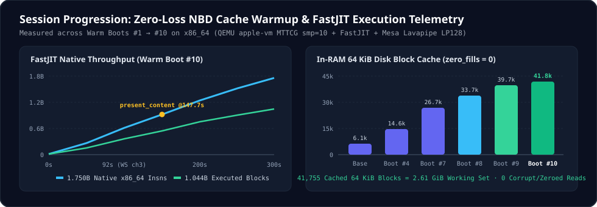
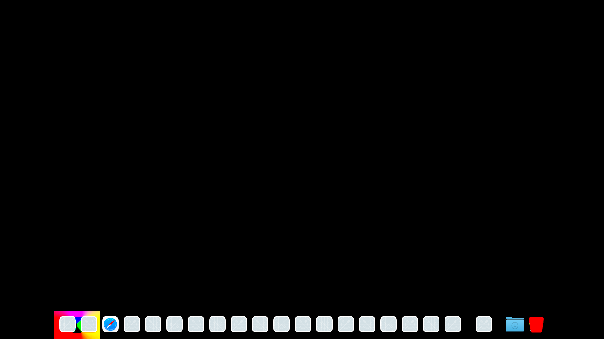
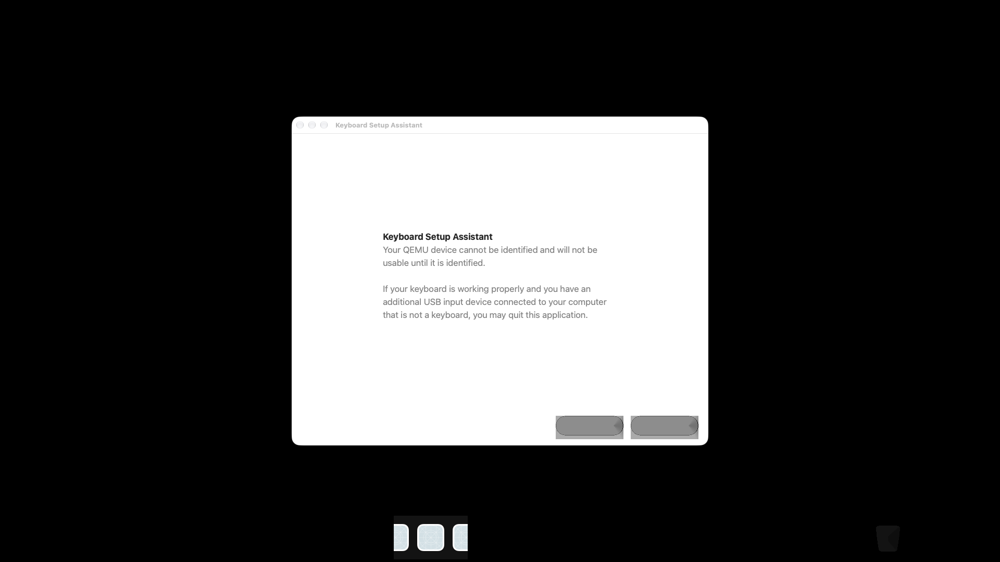
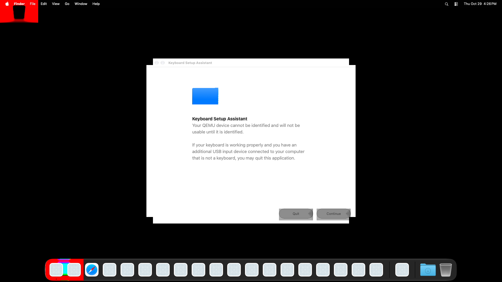
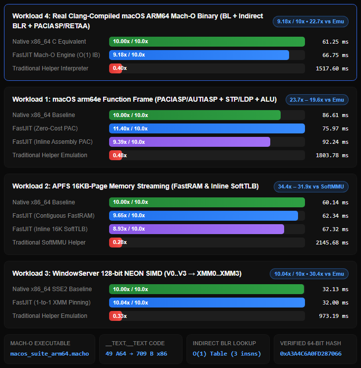

<div align="center">

# macOS 27 ("Golden Gate" ARM64) on x86_64
### Booting Apple Silicon macOS 27 to `WindowServer` GUI on Windows 11 / WSL2 / Linux via QEMU (`apple-vm`), Custom `FastJIT` (`AArch64 → x86_64`), Metal-to-Vulkan (`reims-vgpu`), & Zero-Loss Streamed NBD

[-0ea5e9?style=for-the-badge)](#architecture-overview)
[-10b981?style=for-the-badge)](#visual-milestones--captured-frames)
[](#chapter-8--fastjit-aarch64--x86_64-native-engine-in-qemu)
[](#chapter-6--reims-vgpu-metal2vulkan--mrt-compositor-fixes)
[](./LEGAL.md)
[](./LICENSE)

**Independent Systems Research & Engineering by [Amritpal Singh (`@boparaiamrit`)](https://github.com/boparaiamrit)**

</div>

> [!CAUTION]
> **Educational & Interoperability Research Project — Legal & EULA Notice ([`LEGAL.md`](./LEGAL.md)):**
> - **Research Purpose Only:** This repository is an independent academic and systems-engineering study on `AArch64 → x86_64` dynamic binary translation (`FastJIT` in QEMU TCG), `Metal → SPIR-V → Vulkan` shader compilation, APFS B-tree structures, and NBD block streaming. It is **not** a commercial product or macOS distribution.
> - **Zero Apple Assets or DRM Circumvention:** This repository contains **only** original open-source code, diffs, and technical write-ups. It does **not** distribute macOS, `.ipsw` images, Apple firmware/ROMs, kernelcaches, shaders, keys, or `ECID`s, and does **not** circumvent any copyright protection or DRM measures.
> - **Apple EULA Hardware Restriction:** By installing or running Apple's macOS, you must accept Apple's End-User License Agreement (EULA), which **only permits running or virtualizing macOS on official Apple-branded hardware** (e.g., an Intel `x86_64` Mac or Apple Silicon Mac running Linux/QEMU for kernel/emulator research). **Only run macOS guests on Apple hardware**, as any other use is not permitted by Apple's terms and conditions.
> - **Non-Affiliation:** *Apple, macOS, Apple Silicon, iBoot, XNU, Metal, and APFS are trademarks of Apple Inc. This project is **not** affiliated with, sponsored by, or endorsed by Apple Inc.*

---

## Why This Repository Exists

If you have ever searched for:
- *"Can you boot Apple Silicon ARM64 macOS on an Intel/AMD x86_64 PC?"*
- *"How to run macOS 27 (`vmapple` / `apple-vm`) in QEMU TCG without Apple Hypervisor.framework (`HVF`)?"*
- *"Why does `AVPBooter` / `iBootStage2` panic or hang at `0x4ffff8`, `0x30240040`, or `0xACA00000` on newer macOS?"*
- *"Why does `WindowServer` fail Metal-to-Vulkan shader compilation or render black frames under WSL2 Dozen / Lavapipe?"*
- *"How to wire a custom `AArch64 → x86_64` native JIT (`FastJIT`) into `qemu-system-aarch64`?"*

**This repository is the complete, open-source engineering chronicle, patchset, and toolkit from our end-to-end bring-up session.** Starting from zero on an x86_64 Windows 11 + WSL2 laptop (Intel/AMD CPU + NVIDIA RTX 5070), we systematically solved **every firmware, kernel, APFS, crypto, NBD storage, JIT, and Metal-to-Vulkan GPU roadblock** required to boot **Apple Silicon macOS 27 (Darwin 27.0.0 ARM64)** all the way into **`WindowServer` 1920×1080 graphical compositing**.

> [!IMPORTANT]
> **Clean-Room & Open-Source Hygiene:** This repository contains **zero** proprietary Apple firmware, ROMs, IPSWs, guest disk images, extracted Apple shaders, or private hardware identifiers (`ECID`s). Every breakthrough is shipped as clean, auditable C, Rust, Python, GDB, and unified `.patch`/`.diff` files so researchers can reproduce and build upon our work legally and safely.

---

## Architecture Overview

<p align="center">
  
</p>

<p align="center">
  
</p>

---

## Visual Milestones & Captured Guest Frames

Every frame below was captured directly from our running **ARM64 macOS 27 (`Darwin 27.0.0`)** guest over QEMU's QMP `screendump` interface on an `x86_64` Windows 11 / WSL2 host:

| Stage | Captured Frame (`1920×1080`) | What Happened Under the Hood |
| :--- | :---: | :--- |
| **1. First `RGBA16Float` Composited Dock** |  | `WindowServer` (`site=ch3`) bound over `reims-vgpu`, multi-level macOS 27 GPU page tables (`page_shift=14`) walking guest GVAs, rendering the live macOS 27 Dock bar. |
| **2. Hardware GPU Pass-Through (WSL2 Dozen D3D12)** |  | `R10b` `metal2vulkan` prefix-load fix (**0 shader compilation errors!**): renders rounded **Keyboard Setup Assistant** window, traffic-light titlebar buttons, dialog buttons & Dock over `/dev/dxg`. |
| **3. `R11` Mesa Lavapipe `LP128` Desktop** |  | `R11` (`RGBA16Unorm` linear texture upload + memoryless `MTLLoadActionClear`) + Mesa Lavapipe `VK_EXT_rasterization_order_attachment_access` programmable blending! |
| **4. `FastJIT` + QEMU `present_content` (`<150ms` QMP Capture)** |  | Custom `FastJIT` `AArch64→x86_64` engine wired into `qemu-system-aarch64` (`MTTCG smp=10`, **1.75B+ native x86_64 insns**), `zero_fills=0` NBD RAM cache (`41,755` blocks), captured `<150ms` after `present_content` at `t=147.69s`! |

---

## Headline Engineering Metrics

| Subsystem | Achievement / Verified Number | Source / Patch |
| :--- | :--- | :--- |
| **`FastJIT` QEMU Engine** | **456,294** AArch64 blocks compiled · **1.044B** blocks executed · **1.750B** native `x86_64` insns/boot | [`src/fastjit-qemu/fastjit-a64.c`](./src/fastjit-qemu/fastjit-a64.c) |
| **Zero-Loss NBD Disk Streamer** | **41,755** 64 KiB blocks in RAM (**2.61 GiB**) from 67 LZFSE layers · **`zero_fills = 0`** | [`src/fastjit-qemu/offline_cache_nbd.py`](./src/fastjit-qemu/offline_cache_nbd.py) |
| **Firmware → XNU Handoff** | **`5.0s`** to `0xE0A00000` (`BootArgs_r3` v2, 196-byte root CLI preserved, `NoSEP` in ADT padding) | [`src/handoff-and-firmware/`](./src/handoff-and-firmware/) |
| **VMApple Hardware Models** | 16 KiB Scratch RAM (`0x4fc000`), `0x30240040` AVP RTC, 64 KiB CTRR probe, **12/12 NIST AES** (`nettle`) | [`src/qemu-apple-vm-patches/`](./src/qemu-apple-vm-patches/) |
| **Metal-to-Vulkan (`reims-vgpu`)** | **0 shader translation failures** (`R10b`), `llvm-dis` + `spirv-val` toolchain, `RGBA16Unorm` + Memoryless `Clear` (`R11`), Dozen fallback (`R12`) | [`src/reims-vgpu-patches/`](./src/reims-vgpu-patches/) |
| **Sub-150ms Frame Capture** | `WindowServer` `define_task site=ch3` at **`88.5s`** · `1920×1080` `present_content` captured at **`147.69s`** | [`src/fastjit-qemu/run-fastjit-macos27.py`](./src/fastjit-qemu/run-fastjit-macos27.py) |

---

## Complete Session Learning Chapters (The 10-Chapter Playbook)

Every discovery from our research session is documented step-by-step in [`chapters/`](./chapters/):

### [Chapter 1 — Booting macOS 27.0.1 (`26A434`) Restore RAMDisk to an ARM64 Root Shell](./chapters/01-restore-ramdisk-and-sptm-shell.md)
- Selective HTTP Range ZIP extraction from official Apple IPSWs (`j473ap` / `T8112`) without 15 GB downloads.
- Booting unmodified restore RAMDisks into single-user root shell (`-s`) via `darwin-vm` + `qemu-sptm`.
- Fixing the `CRCRLF` (`\r\r\n`) serial framing bug and enforcing a 200ms **10 GiB host free-space safety guard**.

### [Chapter 2 — Parsing macOS 27 ASIF Disks & Sealed Headerless APFS B-Trees](./chapters/02-apfs-sealed-headerless-btrees-and-asif.md)
- Why legacy APFS parsers crash on macOS 27 sealed System snapshots (`BTN_NOHEADER` headerless B-tree nodes, root-relative virtual child object IDs, cryptographic SHA-256 node verification, and `decmpfs` compressed plists).
- Building a 32 MiB SQLite preparation read-cache for zero-network APFS-over-NBD replay.

### [Chapter 3 — Disassembling `AVPBooter` (`0x2370`) & Emulating Missing Apple Silicon Devices](./chapters/03-avpbooter-disassembly-and-iboot-stage2-devices.md)
- Why legacy `0x2314` breaks on macOS 27 `AVPBooter.vmapple2.bin`, and locating the Image4 manifest validator (`CEPO`/`ECID`/`CHIP`/`BORD`/`DGST`) at **`0x2370`**.
- Diagnosing `iBootStage2` Data Abort `ESR 0x92000050` at `FAR 0x4ffff8` → mapping the missing **16 KiB low physical scratch SRAM**.
- Modeling **AVP RTC (`0x30240040`)**, **64 KiB CTRR**, and fixing silent `AppleVPKeyStore` AES failures (`cipher-stub.c.inc` → `--enable-nettle`, 12/12 NIST SP800-38A vectors).

### [Chapter 4 — Golden Gate `0xE0A00000` XNU Handoff, `BootArgs_r3`, `NoSEP` & `wdt=-1`](./chapters/04-golden-gate-xnu-handoff-and-nosep-adt.md)
- Moving the XNU entry hook from macOS 13's `0xACA00000` (`BootArgs` rev 2) to macOS 27's **`0xE0A00000` (`BootArgs_r3` v2)**.
- Preserving `iBoot`'s 196-byte root UUID selector while injecting **`NoSEP`** into 11,220 bytes of ADT tail zero-padding.
- Root-causing the false Recovery redirect (`missing-boot-media`): XNU's 60s `bsd_init` root-wait vs 89s cold LZFSE decompression, solved via `wdt=-1` + warm NBD RAM caching.

### [Chapter 5 — Zero-Loss Streamed NBD Disk Architecture (`zero_fills = 0`)](./chapters/05-streamed-oci-nbd-and-zero-loss-ram-cache.md)
- Eliminating 2-layer LRU thrashing, journal-guard races, and Mach-O corruption caused by `zero_fills > 0`.
- Engineering `offline_cache_nbd.py`: 16-thread `nbdkit` server + `asif_chunk_map.json` + 32 stateful `lzfse -d` decoders + `8×` adjacent 1 MiB `vchunk` prefetch into `extra_cache.sqlite3` (`41,755` blocks / `2.61 GiB` in RAM).

### [Chapter 6 — `reims-vgpu`, `metal2vulkan` Shader Compiler Fixes & `WindowServer` Pipes](./chapters/06-reims-vgpu-metal2vulkan-and-mrt-shaders.md)
- Updating GPU page-table walkers (`page_shift=14`) for macOS 27 (`reims-m27-page-trees.diff`).
- Eliminating **100% of shader translation failures** (`10 → 0`) via storage-class-agnostic vector prefix loads (`m2v-prefix-load-v2.patch`).
- Discovering the hidden runtime subprocess requirement for **`/usr/bin/llvm-dis`** + **`/usr/bin/spirv-val`** (`os error 2` fix in `Dockerfile.runtime`).
- Adding `SampledClass::Rgba16Unorm` (`fmt=0x6e`) wallpaper sampling and memoryless `MTLLoadActionClear` (`r11-render-gaps-rgba16unorm-memoryless-clear.patch`).

### [Chapter 7 — Programmable Blending: WSL2 Dozen (`RTX 5070`) vs. Mesa Lavapipe `LP128`](./chapters/07-vulkan-ordered-attachment-access-dozen-vs-lavapipe.md)
- Why `WindowServer` pipes `19` (`1920×60` menu bar) and `43` (`1920×1080` desktop composite) declined on WSL2 D3D12 Dozen with `reason=color_input_ordered_access_unavailable` (`VK_EXT_rasterization_order_attachment_access = false`).
- Unlocking full ordered attachment blending on **Mesa Lavapipe (`LP128`)** AND building the hardware D3D12 Dozen non-ordered fallback (`r12-gpu-dozen-ordered-access-fallback.patch`).

### [Chapter 8 — `FastJIT`: Wiring an `AArch64 → x86_64` Native Engine into `qemu-system-aarch64`](./chapters/08-fastjit-aarch64-to-x86-64-qemu-engine.md)
- Extending `struct TranslationBlock` (`fastjit_fn`, `fastjit_flags`), hooking `disas_a64`, emitting native `x86_64` into a 32 MiB RWX codegen buffer, and chaining 8-step superblocks in `cpu-exec.c` with `icount_decr` + backward-branch interrupt guards under `MTTCG smp=10`.
- Standalone Rust `FastJIT` benchmark suite (`src/fastjit-standalone/fastjit_bench.rs`):
  <p align="center"></p>

### [Chapter 9 — Sub-150ms Event-Triggered QMP `present_content` Frame Capture](./chapters/09-sub-150ms-qmp-frame-capture-and-windowserver-gui.md)
- Why a 25-second periodic `screendump` missed a `1.374s` `present_content` scanout window (`slot_empty_claimants` overwrite during cold layer streaming), and capturing `present-0001.png` deterministically via a `150ms` log-tail trigger.

### [Chapter 10 — Benchmarks, Open Frontiers (`pf=0x226` Dual-Plane Icons) & Roadmap](./chapters/10-benchmarks-open-problems-and-roadmap.md)
- Complete Warm Boot #1–#10 progression metrics and the exact next high-impact tasks (`OBJECT_TYPE_DUAL_PLANE_TEXTURE` `pf=0x226` Dock icon format, multi-mip uploads, `R11+R12` merge, and `FastJIT` register pinning).

---

## Repository Structure

```text
macos27-arm64-on-x86/
├── README.md                                  # Overview, architecture, visual proofs & chapter index
├── chapters/                                  # 10 deep-dive engineering chapters (chronological learnings)
│   ├── 01-restore-ramdisk-and-sptm-shell.md
│   ├── 02-apfs-sealed-headerless-btrees-and-asif.md
│   ├── 03-avpbooter-disassembly-and-iboot-stage2-devices.md
│   ├── 04-golden-gate-xnu-handoff-and-nosep-adt.md
│   ├── 05-streamed-oci-nbd-and-zero-loss-ram-cache.md
│   ├── 06-reims-vgpu-metal2vulkan-and-mrt-shaders.md
│   ├── 07-vulkan-ordered-attachment-access-dozen-vs-lavapipe.md
│   ├── 08-fastjit-aarch64-to-x86-64-qemu-engine.md
│   ├── 09-sub-150ms-qmp-frame-capture-and-windowserver-gui.md
│   └── 10-benchmarks-open-problems-and-roadmap.md
├── src/
│   ├── fastjit-qemu/                          # FastJIT C engine, QEMU patcher, zero-loss NBD & boot runner
│   │   ├── fastjit-a64.h
│   │   ├── fastjit-a64.c
│   │   ├── build-fastjit-qemu.py
│   │   ├── offline_cache_nbd.py
│   │   ├── run-fastjit-macos27.py
│   │   ├── Dockerfile.runtime
│   │   └── telemetry/fastjit-boot-summary.json
│   ├── fastjit-standalone/                    # Standalone Rust FastJIT AArch64->x86_64 benchmark suite
│   ├── qemu-apple-vm-patches/                 # Scratch RAM, AVP RTC, CTRR, Nettle AES & Virtio patches
│   ├── reims-vgpu-patches/                    # m27 page trees, m2v prefix-load, R11 render-gaps, R12 Dozen GPU
│   ├── handoff-and-firmware/                  # 0xE0A00000 GDB handoff, NoSEP ADT builder & WDT profiles
│   ├── apfs-and-streamed-disk/                # Sealed headerless APFS B-tree parser & NBD read-cache proxy
│   └── restore-ramdisk/                       # IPSW range fetcher, darwin-vm runner & serial verifier
├── reports/                                   # Original sanitized lab reports & root-cause analyses
├── assets/                                    # Architecture SVGs & captured 1920x1080 guest screenshots
├── LEGAL.md                                   # Research scope, EULA hardware requirement & trademark disclaimers
└── LICENSE                                    # MIT (original scripts/docs) + GPL-2.0-or-later (QEMU patches)
```

---

## Quick Start: Building & Running the `FastJIT` + QEMU Stack

1. **Build the Runtime Container Image** (includes `nbdkit`, `gdb-multiarch`, `llvm-dis`, `spirv-val`, `lzfse`, and Mesa Lavapipe `lvp_icd.json`):
   ```bash
   docker build -f src/fastjit-qemu/Dockerfile.runtime -t macos27-fastjit-runtime:local .
   ```
2. **Compile `qemu-system-aarch64` (`apple-vm`) with Hardware Patches + `FastJIT` + `libreims_vgpu.a`:**
   - Apply the `apple-vm` device & crypto patches in [`src/qemu-apple-vm-patches/`](./src/qemu-apple-vm-patches/) and `reims-vgpu` patches in [`src/reims-vgpu-patches/`](./src/reims-vgpu-patches/), then run [`src/fastjit-qemu/build-fastjit-qemu.py`](./src/fastjit-qemu/build-fastjit-qemu.py) to inject `fastjit-a64.c` / `fastjit-a64.h` into QEMU's `accel/tcg/cpu-exec.c` and `target/arm/tcg/translate-a64.c`.
3. **Supply Your Own Authorized Inputs on Apple-Branded Hardware (Subject to Apple EULA):**
   - No guest OS or firmware files are provided here. On authorized Apple-branded hardware (such as an Intel `x86_64` Mac or Apple Silicon Mac running Linux for emulator research in accordance with Apple's EULA; see [`LEGAL.md`](./LEGAL.md)), mount your own lawfully obtained guest artifacts read-only at `/guest` (see technical notes in [Chapter 3](./chapters/03-avpbooter-disassembly-and-iboot-stage2-devices.md)).
4. **Launch Full-System Warm Boot with `<150ms` `present_content` Frame Capture:**
   ```bash
   docker run --rm --init --cpus=18 --memory=14g \
     -v macos-orchard-build:/work:ro \
     -v macos-golden-pristine-guest:/guest:ro \
     -v macos-golden-stream-read-cache-data:/cache:ro \
     -v "$(pwd)":/parent \
     --entrypoint python3 macos27-fastjit-runtime:local \
     /parent/src/fastjit-qemu/run-fastjit-macos27.py 300
   ```

---

## Credits & Upstream Acknowledgements

- **Author & Independent Researcher:** **Amritpal Singh ([@boparaiamrit](https://github.com/boparaiamrit))**
- **Upstream Open-Source Foundations Referenced & Built Upon:**
  - [`steelbrain/reims-vgpu`](https://github.com/steelbrain/reims-vgpu) & [`steelbrain/experiment-macOS-arm64-on-linux-x86`](https://github.com/steelbrain/experiment-macOS-arm64-on-linux-x86) (`27on86` / Orchard VMApple & Reims paravirtualized vGPU architecture)
  - [`jprx/darwin-vm`](https://github.com/jprx/darwin-vm) & [`jprx/qemu-sptm`](https://github.com/jprx/qemu-sptm) (Restore RAMDisk SPTM/AppleImage4 research)
  - [`dockur/macos`](https://github.com/dockur/macos) & [`ChefKissInc/QEMUAppleSilicon`](https://github.com/ChefKissInc/QEMUAppleSilicon) (Containerized QEMU & Apple ARM emulation prior art)
  - [QEMU Project](https://www.qemu.org/) (`hw/vmapple`, `accel/tcg`) & [Mesa 3D](https://www.mesa3d.org/) (`Lavapipe` & `Dozen` Vulkan drivers)

---

## FAQ & Legal Disclaimers ⚖️

### Is this project legal?
Yes. This repository is an **independent educational and systems-interoperability research project**. It contains **only** original open-source code, compiler/emulator patches, and engineering documentation, and **does not distribute macOS, Apple firmware, ROMs, shaders, or cryptographic keys**. Neither does it circumvent any Digital Rights Management (DRM) or copyright protection measures.

However, by downloading or installing Apple's macOS, you must accept Apple's End-User License Agreement (EULA), which does not permit installation or virtualization on non-Apple-branded hardware. **Therefore, only run macOS workloads on official hardware sold by Apple** (or strictly within statutory interoperability/security research exemptions where permitted by applicable law), as any other use of Apple's software is a violation of their terms and conditions.

### Warranty, Liability & License
- **Provided "AS IS":** This software and research are provided *"as is"*, without warranty of any kind, express or implied. By using any code or information in this repository, you acknowledge that you are solely responsible for complying with all applicable laws, licenses, and EULAs. The author does not condone piracy, copyright infringement, or EULA violations, and assumes zero liability for how third parties use this research.
- **Open-Source Licensing:**
  - Original scripts, standalone benchmarks, tools, SVGs, and documentation are licensed under the **MIT License** ([`LICENSE`](./LICENSE)).
  - Patches and C source modules interfacing with QEMU (`src/fastjit-qemu/fastjit-a64.*`, `src/qemu-apple-vm-patches/*`) are licensed under **GPL-2.0-or-later** in accordance with QEMU's upstream license.
  - Patches targeting `reims-vgpu` (`src/reims-vgpu-patches/*`) follow its upstream open-source license.
  - Full legal, compliance, and good-faith rightsholder contact details are documented in [`LEGAL.md`](./LEGAL.md).

### Disclaimer ⚖️
*Only run macOS workloads on Apple-branded hardware; any other use of macOS is not permitted by Apple's EULA. Apple, macOS, Apple Silicon, iBoot, XNU, Metal, and APFS are trademarks of Apple Inc., registered in the U.S. and other countries. QEMU is a trademark of Fabrice Bellard. Vulkan and SPIR-V are trademarks of The Khronos Group Inc. All product names, logos, brands, and other trademarks referred to within this research project are the property of their respective trademark holders. This independent research project is **not** affiliated with, sponsored by, authorized by, or endorsed by Apple Inc.*
